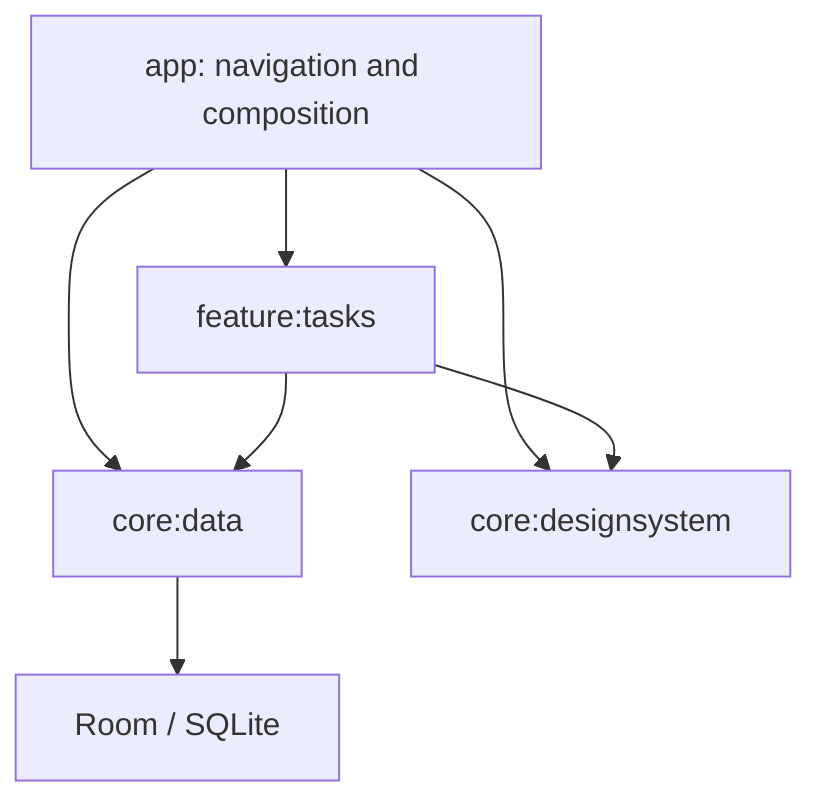

# Architecture

The foundation is a small modular app with real boundaries, not a generic application framework.

## Data flow

Compose reads `TasksUiState` with lifecycle-aware collection and sends actions to `TasksViewModel`.
The ViewModel depends on `TasksRepository`, not a DAO, Context, Activity or database singleton.
`RoomTasksRepository` maps persistence entities to models and uses suspend DAO writes. Database
observation supplies the single persisted source of truth; the UI does not pretend a failed write succeeded.

The ViewModel scopes operations to its navigation entry. `SavedStateHandle` stores the draft;
Navigation 3 serializable keys and entry decorators retain back stack, saveable UI state and ViewModel
ownership. Only destination identifiers belong in navigation, never serialized credentials or whole entities.

Failed reads produce explicit state with retry. Failed writes retain input and display a recoverable error.
Cancellation is rethrown. A late save clears only the submitted draft, preserving newer typing.
Duplicate submissions are prevented while a write is active. Record updates/deletes target stable IDs;
there is no read-list/replace-table edit path and no second JSON mirror of the database.

## Dependency injection

Hilt builds the application graph. Constructors expose dependencies; the data module uses application
context only to create Room. Fakes implement the repository contract in tests. There are no service
locators, base ViewModels, base repositories, generic resource wrappers or inheritance hierarchies to
force unrelated features into one shape.

The core data module owns the example contract/model as well as its implementation to keep the initial
surface small. Extract a pure Kotlin model/contract module when actual sharing or build isolation
justifies it. Add a domain/use-case layer only for reused or complex business operations.

## Adding infrastructure

- Preferences: use DataStore behind a repository; create one store instance per file. Do not add
  preference access directly to a ViewModel or composable.
- Network: add a data source/client at a real backend boundary. Prefer a typed API, explicit timeouts,
  safe retries, HTTPS, cancellation, structured errors and tests with a fake/mock server. Do not expose
  transport response classes to UI. Credentials are configured by the consuming product.
- Background work: use WorkManager for deferrable durable work, with idempotency and retry limits.
- Authentication, billing, notifications and analytics: separate product integrations with focused
  contracts, least privilege and integration tests. They are not mandatory foundation dependencies.
- Performance: add baseline profiles and macrobenchmarks for meaningful product journeys before
  performance claims. Avoid copying product-specific Quick Search profiles.

Keep dependency direction acyclic. `scripts/check_architecture.py` enforces the initial graph and
specific forbidden patterns; it is a bounded guardrail, not a complete Kotlin semantic analyzer.

Sources: [Google architecture recommendations](https://developer.android.com/topic/architecture/recommendations),
[coroutine practices](https://developer.android.com/kotlin/coroutines/coroutines-best-practices),
[Navigation 3 state](https://developer.android.com/guide/navigation/navigation-3/save-state).
