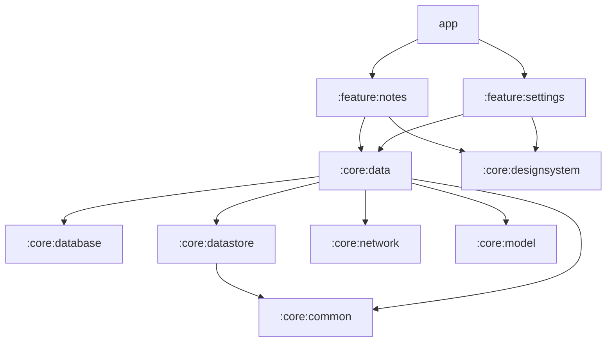

# Architecture

Follows Google's [Guide to app architecture](https://developer.android.com/topic/architecture) and
[architecture recommendations](https://developer.android.com/topic/architecture/recommendations),
with the module layout of [Now in Android](https://github.com/android/nowinandroid).

## Layers

```
UI (Compose screen)  ──events──▶  ViewModel  ──calls──▶  Repository (interface)
        ▲                           │                         │
        └──── StateFlow<UiState> ◀──┘          Room DAO / DataStore / Retrofit
```

- **UI**: stateless `XScreen(uiState, onEvent…)` composables plus a thin `XRoute` that connects the
  ViewModel. Screens never see repositories, `Context`-based APIs for data, or other ViewModels.
- **ViewModel**: one per screen, exposes a single `StateFlow<XUiState>` and plain functions for
  events. No Android `Context`, no navigation calls, no `Toast`.
- **Data**: repositories are interfaces in `:core:data`, the only way features reach data.
  Implementations are `internal` and bound with Hilt `@Binds`.
- There is no separate domain (use-case) layer. Add one in `:core:domain` only when logic is shared
  by several ViewModels; Google lists it as optional.

## Modules



| Module | Owns |
| --- | --- |
| `:app` | `Application`, the single `MainActivity`, app theme selection, navigation shell and back stack |
| `:feature:*` | Screens, ViewModels and `NavKey`s for one user-facing area |
| `:core:data` | Repository interfaces and implementations |
| `:core:database` | Room database, entities, DAOs, exported schemas |
| `:core:datastore` | Preferences DataStore for small settings |
| `:core:network` | OkHttp, Retrofit and JSON configuration |
| `:core:model` | Plain Kotlin domain models (no Android dependency) |
| `:core:common` | Dispatcher and scope qualifiers, `Clock`, `suspendRunCatching` |
| `:core:designsystem` | Theme, tokens, shared components, preview annotations |
| `:core:testing` | Fakes and test rules shared by tests |
| `:benchmark` | Baseline Profile generation and startup benchmarks |

Rules, enforced by the build where possible:

- Features never depend on other features (the feature convention plugin fails the build).
- Features depend on `:core:data`, never on `:core:database`, `:core:datastore` or `:core:network`.
- `:core:model` has no Android dependency, so it can move to Kotlin Multiplatform later.
- Module build files stay short: shared setup lives in `build-logic` convention plugins.

## Navigation

Single activity with [Navigation 3](https://developer.android.com/guide/navigation/navigation-3).

- Each feature exposes `@Serializable` `NavKey`s and an `EntryProviderScope.xEntries(...)` function
  that takes navigation callbacks. Features never touch the back stack.
- `:app` owns the back stack (`rememberNavBackStack`, saved across process death) and wires the
  callbacks in `FoundationApp`. Pure helpers in `navigation/TopLevelDestination.kt` hold the rules
  and are unit-tested.
- Each entry gets its own `ViewModelStore` (`rememberViewModelStoreNavEntryDecorator`), so a
  screen's ViewModel is cleared when it is popped.
- `NavigationSuiteScaffold` shows a bottom bar, rail or drawer based on window size, and hides it on
  detail screens.

## State and threading

- UI state: `StateFlow` built with `stateIn(viewModelScope, WhileSubscribed(5_000), Loading)` and
  collected with `collectAsStateWithLifecycle()`.
- Text input: `TextFieldState` held by the ViewModel and saved through `SavedStateHandle`, so typing
  is never delayed and drafts survive process death.
- One-off results (saved, deleted, error) are fields in the UI state that the UI consumes and
  acknowledges, as Google recommends, rather than event channels.
- Room and DataStore are main-safe. Other blocking work uses an injected
  `@Dispatcher(IO)` dispatcher, never a hard-coded `Dispatchers.IO`.
- Work that must outlive a screen uses the injected `@ApplicationScope`.

## Persistence

- Room for structured and user-generated data: per-row `suspend` writes and `Flow` reads. Never
  read a whole table, modify it and write it back.
- Preferences DataStore for small settings. Stored key names are part of the on-disk format.
- Bump the Room `version` with a migration for every schema change; exported schemas are committed.
- Backup is an allowlist in `app/src/main/res/xml/data_extraction_rules.xml` and
  `backup_rules.xml`. Rules work per file, not per key.
